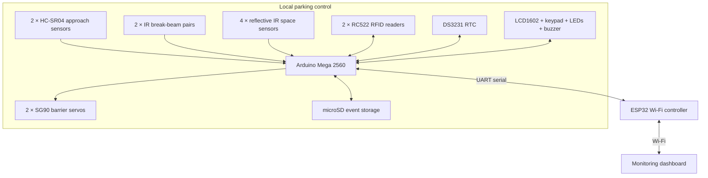

# SmartPark — Automated Parking Management System

**SmartPark** is a university embedded-systems project that turns a miniature parking lot into an automated parking facility. Built around an **Arduino Mega 2560**, the prototype combines RFID-based access control, automatic entrance and exit barriers, individual parking-space detection, and time-based parking fee calculation. An **ESP32** adds Wi-Fi connectivity for a live monitoring dashboard.

> **Project status:** Planning and prototyping · **Development timeline:** 8 weeks  
> **Demo scope:** 4 parking spaces · 2 automatic barriers · 3D-printed physical model

## Project goals

- Automate vehicle entry and exit using RFID authorization and servo-controlled barriers.
- Track the occupancy of **four individual parking spaces** and display availability.
- Detect approaching cars and avoid closing a barrier while a car is in its path.
- Record entry and exit times, calculate parking duration, and demonstrate parking fees.
- Save event history locally and visualize live parking information on a web dashboard.
- Build a presentable physical prototype with **3D-printed parts** and concealed wiring.

## How it works

### Entrance

1. An **HC-SR04 ultrasonic sensor** detects an approaching model car.
2. The driver presents a tag to the **entrance RC522 RFID reader**.
3. The Arduino verifies the tag and checks if a space is available.
4. If access is approved, an **SG90 servo** raises the entrance barrier.
5. An **IR break-beam sensor pair** detects the vehicle crossing and helps prevent premature barrier closure.
6. The system records the parking session and updates availability after confirming entry.

### Parking area

Each of the four parking bays (P1–P4) has a **reflective IR obstacle sensor** and LED indicators. The sensors report actual space occupancy, while the LCD displays available capacity and instructions. An optional enhancement assigns a free space to an arriving driver.

### Exit

1. A second ultrasonic sensor detects a car at the exit.
2. The **exit RFID reader** identifies the active parking session.
3. The **DS3231 real-time clock** supplies the time used to calculate duration and a **simulated** parking fee.
4. The exit servo raises its barrier; a second IR break-beam pair monitors vehicle passage.
5. After departure is confirmed, the session ends and the availability and event log are updated.

The parking system is designed to keep basic local functionality available even without Wi-Fi.

## System architecture



*This diagram shows logical connections, not the final wiring or power schematic.*

## Hardware and components

Quantities below are for the **complete planned prototype**, including items already present in the LAFVIN Mega 2560 starter kit.

### Main modules

| Component | Quantity | Purpose |
| --- | ---: | --- |
| Arduino Mega 2560 | 1 | Main controller for sensors, barriers, and parking logic |
| ESP32 ESP-WROOM-32 development board | 1 | Wi-Fi communication and dashboard connectivity |
| HC-SR04 ultrasonic sensors | 2 | Detect approaching vehicles at the entrance and exit |
| IR break-beam sensor pairs (transmitter + receiver) | 2 pairs | Detect passage/obstruction at each barrier |
| Reflective IR obstacle sensors | 4 | Detect occupancy of parking spaces P1–P4 |
| SG90 micro servo motors | 2 | Raise and lower the entrance and exit barrier arms |
| RC522 13.56 MHz RFID reader modules | 2 | Identify cards at the entrance and exit |
| RFID cards or tags | At least 2 | Represent registered parking users |
| LCD1602 display | 1 | Show availability, messages, and fees |
| 4×4 matrix keypad | 1 | PIN/admin controls and manual input |
| DS3231 real-time clock module | 1 | Provide persistent calendar time for parking sessions |
| microSD reader module + microSD card | 1 each | Store event logs and session history |
| Red LEDs + green LEDs | 4 of each | Indicate occupancy for each parking space |
| Buzzer | 1 | Audio feedback and warnings |

### Power, signal interfacing, and assembly

| Component | Quantity | Why it is needed |
| --- | ---: | --- |
| Regulated 5 V / 3 A DC power adapter | 1 | External power for servos; helps prevent Arduino resets |
| 5.5 × 2.1 mm female DC connector / screw-terminal adapter | 1 | Connects the adapter to the power distribution wiring |
| 3.3 V regulator module | 1 | Supplies the RC522 readers without overloading the Mega's 3.3 V pin |
| **SPI-compatible** 5 V ↔ 3.3 V level shifting | As required | Protects 3.3 V RFID inputs from the Mega's 5 V signals |
| UART voltage adaptation (e.g., resistor divider / suitable level shifter) | 1 | Protects the ESP32 RX input from the Mega's 5 V TX output |
| 1000 µF electrolytic capacitors, rated **at least 10 V** | 1–2 | Helps smooth servo supply transients |
| Jumper wires, insulated cable, resistors | Assortment | Sensor connections, power distribution, LED current limiting |
| Terminal blocks, perfboard, headers, fasteners | As needed | More reliable final wiring and mechanical mounting |
| PLA filament and 3D-printed brackets/enclosures | As needed | Barriers, posts, RFID terminals, display and electronics housings |
| Model cars and a ~60 × 45 cm base | 1 set | Physical demonstration of the parking lot |

**Starter-kit reuse:** The Mega, one ultrasonic sensor, one servo, one RFID reader, LCD, keypad, RTC, LEDs, buzzer, and many basic electronic parts are already included in the LAFVIN kit. The remaining quantities can be purchased separately.

## Why some less-obvious components are necessary

| Component | Design reason |
| --- | --- |
| **IR break-beam sensors** | An ultrasonic sensor detects a car *approaching* the gate, but cannot reliably tell whether it is still crossing. A transmitter/receiver beam provides a dedicated obstruction signal. One beam alone does **not** establish travel direction; the gate state machine must track the expected sequence. |
| **DS3231 RTC** | `millis()` measures time since startup, not real dates and times, and resets on power loss. The RTC enables meaningful entry/exit timestamps and fee calculation. |
| **microSD module** | Arduino RAM is volatile and limited. A microSD card supports CSV event logs, debugging, and historical parking-session records even after a restart. |
| **ESP32** | The Mega is responsible for hardware control and has many I/O pins but no built-in Wi-Fi. The ESP32 provides networking without making the core parking operation dependent on a dashboard connection. |
| **External 5 V supply** | Servo motors can briefly draw substantial current. Powering them directly from the Arduino may cause voltage drops or resets. |
| **1000 µF capacitor** | Bulk decoupling near the servo power rails reduces short voltage dips. It supplements—but does not replace—a correctly rated power supply. |
| **3.3 V regulator** | The RC522 modules require 3.3 V power. The Mega's onboard 3.3 V output has limited current capacity, so a separate regulator provides more headroom for two readers. |
| **Logic-level shifting** | A 3.3 V **power supply** does not make 5 V communication signals safe. The Mega-to-RC522 SPI signals and Mega-to-ESP32 UART signal must be voltage-compatible. |

## Electrical design notes

> **Important:** These are integration rules, not a final pin-by-pin wiring diagram. Verify each module's exact pinout and voltage limits before connecting it.

- During development, power the **Arduino Mega** and **ESP32** via their USB connections and power the **two servos** from the external regulated **5 V** supply.
- Connect the grounds of all communicating circuits together (**common GND**).
- **Do not** feed the external 5 V adapter into the Mega's barrel jack; that input expects a higher voltage. Do not route servo supply current through the Mega's 5 V pin.
- Keep **RC522 supply and signal levels at 3.3 V** using a regulator and suitable SPI-compatible level shifting. Check the separate microSD module's SPI voltage requirements too.
- Protect the **ESP32 RX** pin from the Mega's 5 V UART output. Check the other direction against the Mega's logic thresholds.
- Fit the electrolytic capacitor across **+5 V and GND**, close to the servo supply distribution point, with correct polarity.
- Confirm the break-beam receiver output type and whether it requires a pull-up. Position sensors so the miniature cars reliably interrupt the beam.
- Treat an obstructed gate as a **do-not-close** condition; include timeouts and fault handling in software.

## Software design (planned)

The Arduino firmware will be written in **C++** with separate responsibilities for:

- `ParkingManager` — overall capacity, space assignments, and active sessions
- `BarrierController` — non-blocking entrance/exit gate state machines
- `RFIDManager` — card identification and access decisions
- `ParkingSpace` — individual bay occupancy monitoring and filtering
- `DisplayManager` — LCD messages, indicators, and keypad interaction
- `StorageManager` — event history and microSD logging
- `CommunicationManager` — serial exchange with the ESP32

The main control loop will use **`millis()` and explicit states** rather than long blocking `delay()` calls so multiple sensors and peripherals can operate together.

### Example barrier states

```text
IDLE -> VEHICLE_DETECTED -> WAITING_FOR_RFID -> OPENING
     -> WAITING_FOR_PASSAGE -> CLOSING -> IDLE

Exceptional cases: ACCESS_DENIED / PARKING_FULL / TIMEOUT / OBSTRUCTION
```

**Access control is demonstrational:** The initial design uses RFID tag identifiers and is not intended to provide production-grade authentication. Fee calculation is simulated; no real payments are collected.

## Physical prototype

The planned model uses a base approximately **60 × 45 cm**, with:

- Four marked parking bays and separate entrance/exit lanes
- Two lightweight boom barriers driven by SG90 servos
- 3D-printed sensor mounts, barrier housings, RFID terminals, and display supports
- Occupancy indicators next to each space
- Electronics and cables secured below or behind the display surface

Final dimensions will be adjusted after choosing the model cars and validating sensor placement.

## Eight-week roadmap

| Week | Focus | Target deliverable |
| --- | --- | --- |
| **1** | Ultrasonic sensing and servo control | Basic automatic barrier prototype |
| **2** | RFID reader and entrance state machine | Authorized/unauthorized access decisions |
| **3** | Four parking-space sensors and indicators | Live occupancy and free-space count |
| **4** | Second gate, break-beams, RTC | Entry/exit tracking with timestamps |
| **5** | CAD, 3D printing, physical assembly | Assembled miniature parking lot |
| **6** | LCD, keypad, pricing, microSD | End-to-end standalone demonstration |
| **7** | ESP32 link and dashboard | Live occupancy and parking statistics |
| **8** | Integration testing, fixes, documentation | University-ready demonstration |

The web dashboard is an **advanced goal**. A reliable standalone parking system takes priority.

## Planned tests

- [ ] Authorized RFID card opens the entrance if capacity is available.
- [ ] Unknown card is rejected.
- [ ] Entrance is denied when all four spaces are occupied.
- [ ] A barrier stays open while its break-beam is interrupted.
- [ ] A vehicle that never crosses the entrance does not create a false parking session.
- [ ] Parking-space occupancy changes update local indicators and the free-space count.
- [ ] Exit identification matches an active entry session.
- [ ] Parking duration and demonstration fee are calculated correctly.
- [ ] Events are written to the microSD card.
- [ ] A Wi-Fi outage does not prevent local parking control.
- [ ] Power interruptions and inconsistent sensor readings fail safely.

## Getting started

The hardware and codebase are being developed incrementally. **A finished firmware build and dashboard installation procedure are not yet available.**

1. Install the **Arduino IDE** or another Arduino Mega-compatible development environment.
2. Start with **one HC-SR04 and one SG90 servo** to verify approach sensing and barrier motion.
3. Add RFID and the break-beam pair, then implement the entrance state machine.
4. Integrate remaining modules **one at a time**, checking supply voltages and grounds before applying power.
5. Add the second barrier, local event logging, and finally ESP32 connectivity.

This README will be updated with source-code directories, wiring diagrams, required libraries, flashing instructions, and dashboard setup as they are implemented.

## References

- [Arduino Mega 2560 documentation](https://docs.arduino.cc/hardware/mega-2560/)
- [NXP MFRC522 RFID reader datasheet](https://www.nxp.com/docs/en/data-sheet/MFRC522.pdf)
- [Espressif ESP32-WROOM-32 documentation](https://documentation.espressif.com/esp32-wroom-32_datasheet_en.html)

---

**SmartPark** is an educational prototype designed to demonstrate embedded programming, sensor integration, finite-state machines, actuator control, local storage, networking, and mechanical prototyping.
